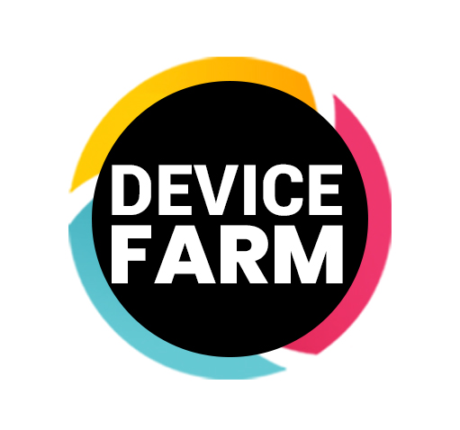

  

This is an Appium plugin designed to manage and create driver sessions on connected Android devices, iOS simulators, and tvOS devices.

:octicons-heart-fill-24:{ .heart } **Why Appium Device Farm?**

-   :status-mgt:{ .device } __Enhanced Session Management__

	---

	Streamline your testing workflow for efficiency with our solution, which simplifies the setup and oversight of driver sessions on iOS simulators, tvOS devices, and Android devices

-   :status-automated:{ .device } __Automated Device Recognition__

	---

	Enjoy a hassle-free testing experience as our system automatically detects connected Android, iOS, and tvOS devices—both simulators and real hardware—prior to session initiation.

-   :status-sync:{ .device } __Proactive Device Pool Management__

	---

	During test execution, our solution updates the device pool with newly available devices, ensuring that your tests run on the latest resources.

-   :status-settings:{ .device } __Parallel Testing Enhancement__

	---

	Facilitate the concurrent running of multiple tests through the allocation of random ports, significantly boosting efficiency and decreasing total testing duration.

-   :status-gps:{ .device } __Remote Testing Facility__

	---

    Cater to the needs of geographically distributed teams or diversified testing settings with capabilities for remote device test executions.

-   :status-livetesting:{ .device } __Manual Device Interaction__

	---

	Grant testers the power for hands-on device control during tests. Whether for exploratory, debugging, or user interaction tests, our platform enhances testing depth and quality by offering complete device commands.

-   :status-remote:{ .device } __Cloud-Based Testing__
    
    ---
 	
	Integrates flawlessly with cloud services, allowing for test executions on cloud-hosted devices, broadening your testing scope.

-   :status-report:{ .device } __Advanced Reporting Insights__

	---

	Equipped with an extensive reporting dashboard, our platform delivers in-depth analyses of your testing outcomes, enabling informed decision-making and strategic planning.

Use the navigation on the left or proceed to [Setup](setup.md)!

## Run on the TestMu AI Mobile Device Cloud

Need more devices than you have on your desk? [TestMu AI](https://www.testmuai.com) (formerly LambdaTest) offers a mobile device cloud with thousands of real Android and iOS devices, so you can run your Appium tests at scale without maintaining a device lab. Appium Device Farm plugs straight into it: point the plugin at the TestMu AI hub and your sessions are allocated to cloud devices just like local ones. See [Cloud](cloud.md#testmu-ai-formerly-lambdatest) for setup.

**Big thanks to the following organizations for their support to the project**

<h3>
	
</h3>
